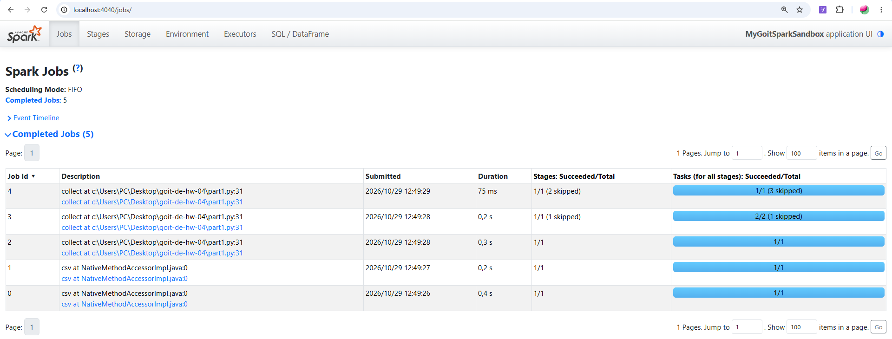
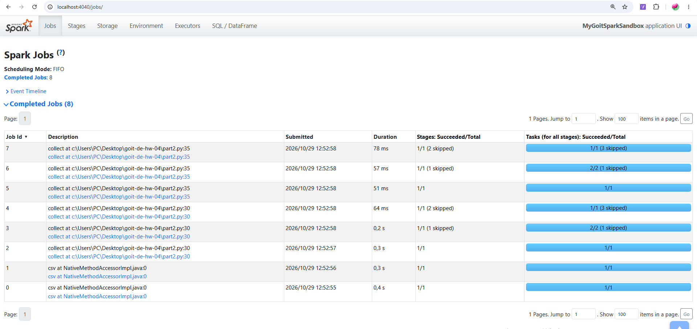
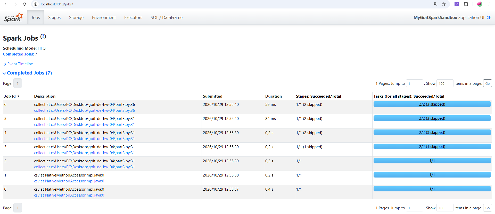

#GoIT Data Engineering HW-04

#Apache Spark Optimization and SparkUI

#Project Description

In this homework, I investigated how Apache Spark executes
DataFrame operations and how intermediate actions and caching
affect the number of Spark Jobs.

I executed three PySpark programs and analyzed their results
using the SparkUI Jobs page.

#Technologies

- Python
- Apache Spark (PySpark)
- SparkUI
- Visual Studio Code

#Dataset

I used the `nuek-vuh3.csv` dataset provided for this assignment.

The dataset is located in `data/nuek-vuh3.csv`.

#Part 1 — Basic Execution

I loaded the CSV dataset, repartitioned it into two partitions,
filtered records where `final_priority < 3`, grouped them by
`unit_id`, and counted the records.

After filtering groups with `count > 2`, I executed `collect()`.

*Result: 5 completed Jobs.*

The two CSV-related Jobs were triggered during schema inference.
The final `collect()` triggered three additional Jobs.

#Part 2 — Intermediate Action

I added an intermediate `collect()` before applying the final
filter.

*Result: 8 completed Jobs.*

The additional action caused Spark to execute the aggregation
before the final result was requested.

Since the intermediate DataFrame was not cached, the final
`collect()` triggered another computation.

This resulted in three additional Jobs compared to Part 1.

## Part 3 — Caching Optimization

I added `cache()` to the aggregated DataFrame.

The first `collect()` computed the intermediate result and
populated the cache.

The second `collect()` reused the cached DataFrame instead
of recomputing the entire aggregation.

*Result: 7 completed Jobs.*

I also used `unpersist()` to release the cached data.

#Results Comparison

| Part | Completed Jobs | Description |
|------|----------------|-------------|
| 1 | 5 | Basic execution |
| 2 | 8 | Additional collect() |
| 3 | 7 | Intermediate result cached |

#Conclusion

I observed that Spark uses lazy evaluation, meaning
transformations are not executed until an action is called.

Adding an intermediate action increased the number of Jobs
from 5 to 8 because Spark executed the computation twice.

Using cache() reduced the number of Jobs from 8 to 7
by allowing Spark to reuse the intermediate result.

This experiment demonstrated how caching can avoid repeated
computations and improve Spark execution efficiency.

